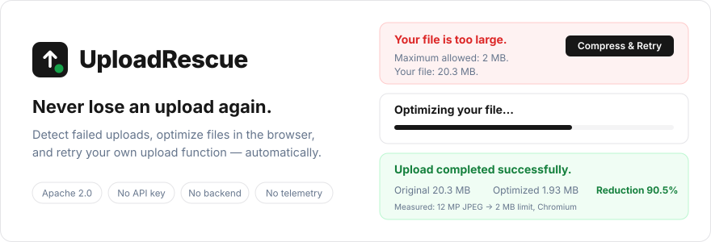
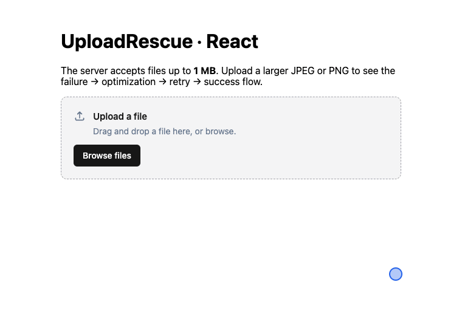
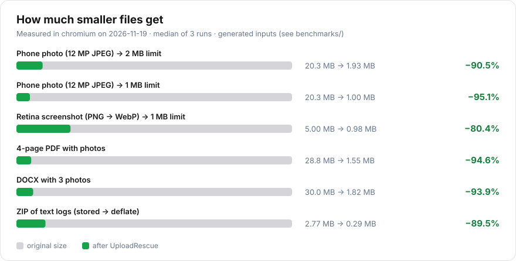
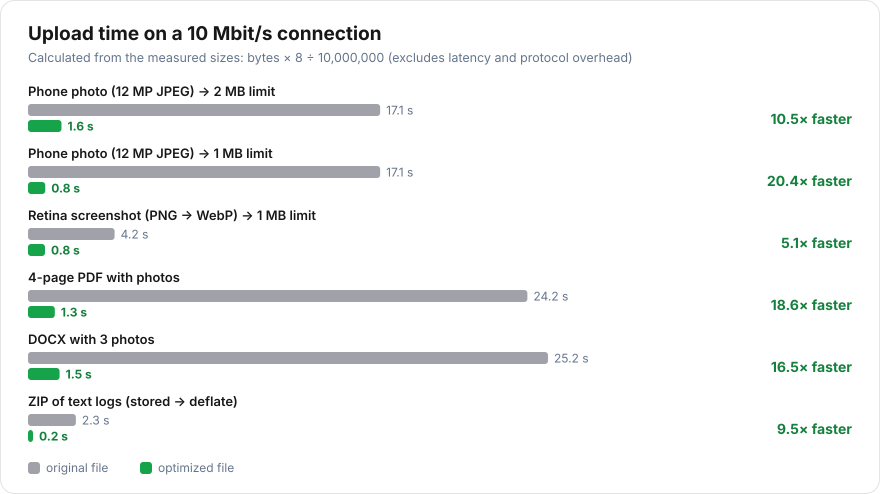
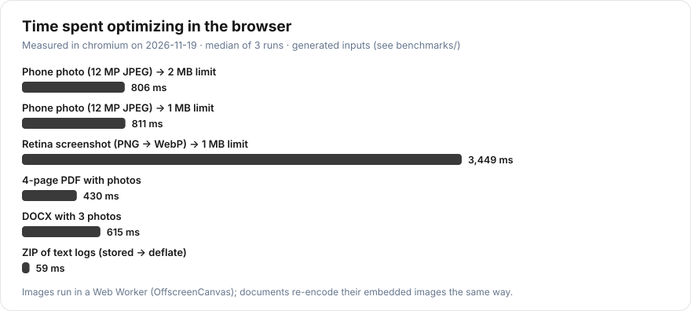
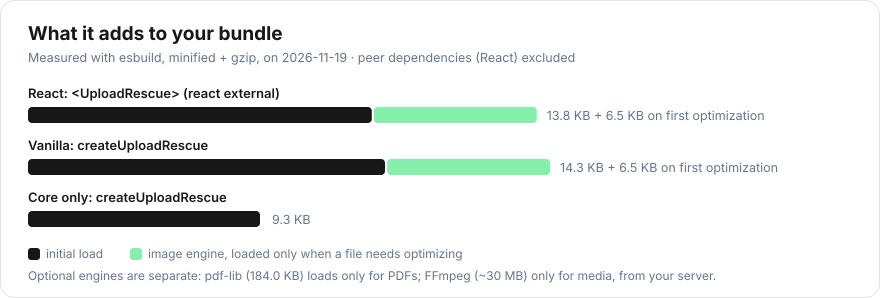
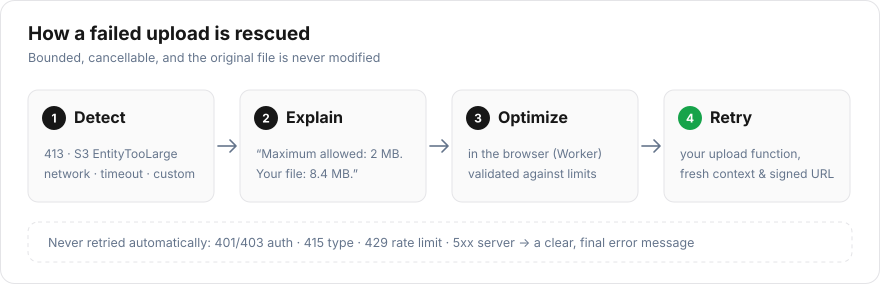
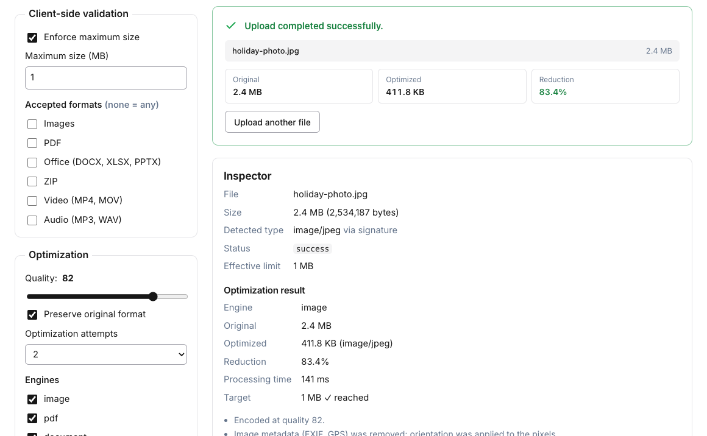
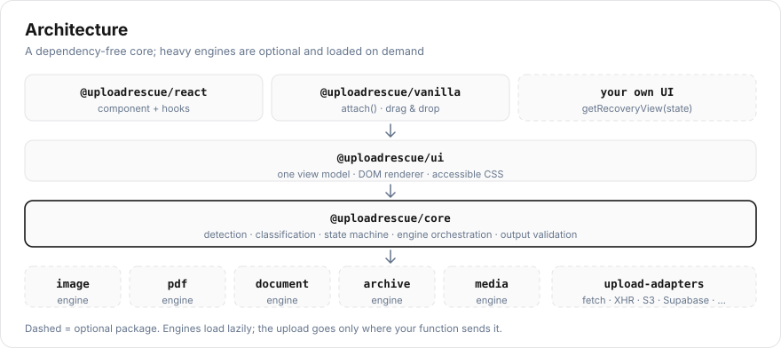

<div align="center">

<picture>
  <source media="(prefers-color-scheme: dark)" srcset=".github/assets/banner-dark.svg">
  
</picture>

<p>
  <a href="LICENSE"></a>
  
  
  <a href="benchmarks/bundle-size.md"></a>
  
</p>

<p>
  <a href="#-quick-start"><b>Quick start</b></a> ·
  <a href="#-what-it-reduces"><b>Results</b></a> ·
  <a href="#-how-it-works"><b>How it works</b></a> ·
  <a href="#-usage"><b>Usage</b></a> ·
  <a href="docs/introduction.md"><b>Docs</b></a> ·
  <a href="apps/website"><b>Playground</b></a>
</p>

</div>

---

**UploadRescue** is an open-source SDK that catches failed file uploads, tells the user exactly what went wrong, shrinks the file **in their browser**, and calls **your own upload function** again — so a "file too large" error becomes a successful upload instead of a lost user.

No API key. No backend. No telemetry. Your files only go where your upload function sends them.

## 🎬 See it work

<div align="center">
  
  <br>
  <sub>
    Recorded from <a href="examples/react"><code>examples/react</code></a>: its <b>real</b> server endpoint rejects files over 1 MB with HTTP 413.
    UploadRescue classifies the 413, compresses the photo locally (1.4 MB → 340.9 KB) and retries the same upload function.
    <a href=".github/assets/demo.mp4">MP4 version</a> · reproduce with <code>node scripts/record-demo.mjs</code>
  </sub>
</div>

### Without vs. with UploadRescue

| Without                                                                          | With UploadRescue                                                      |
| -------------------------------------------------------------------------------- | ---------------------------------------------------------------------- |
| "Upload failed." (or a raw `413 Payload Too Large`)                              | "Your file is too large. Maximum allowed: 1 MB. Your file: 1.4 MB."    |
| User leaves to find a compression website — and uploads their file to a stranger | One click: **Compress & Retry Upload**, processed locally              |
| User guesses a quality setting and tries again (and again)                       | Highest quality that fits the limit is found automatically             |
| Retries on auth/server errors that can never succeed                             | Never retries `401/403`, `415`, `429` or `5xx` — explains them instead |
| Many developers write this logic per project                                     | One SDK, your existing upload code                                     |

## 📉 What it reduces

UploadRescue reduces **file size**, and with it **upload time** and **failed uploads**. Every number below is measured in a real browser by [`pnpm bench`](benchmarks/image.bench.ts) — nothing is estimated.

<picture>
  <source media="(prefers-color-scheme: dark)" srcset=".github/assets/chart-size-dark.svg">
  
</picture>

Smaller files upload faster. The upload times below are **calculated** from the measured sizes (`bytes × 8 ÷ link speed`, no latency or protocol overhead):

<picture>
  <source media="(prefers-color-scheme: dark)" srcset=".github/assets/chart-upload-time-dark.svg">
  
</picture>

| Case                                        | Original | Optimized | Size saved | Time to optimize | Upload @ 10 Mbit/s | Upload @ 2 Mbit/s (slow mobile) |
| ------------------------------------------- | -------- | --------- | ---------- | ---------------- | ------------------ | ------------------------------- |
| Phone photo (12 MP JPEG) → 2 MB limit       | 20.34 MB | 1.93 MB   | **−90.5%** | 806 ms           | 17.1 s → **1.6 s** | 85.3 s → **8.1 s**              |
| Phone photo (12 MP JPEG) → 1 MB limit       | 20.34 MB | 1.00 MB   | **−95.1%** | 811 ms           | 17.1 s → **0.8 s** | 85.3 s → **4.2 s**              |
| Retina screenshot (PNG → WebP) → 1 MB limit | 5.00 MB  | 0.98 MB   | **−80.4%** | 3,449 ms         | 4.2 s → **0.8 s**  | 21.0 s → **4.1 s**              |
| 4-page PDF with photos                      | 28.84 MB | 1.55 MB   | **−94.6%** | 430 ms           | 24.2 s → **1.3 s** | 121.0 s → **6.5 s**             |
| DOCX with 3 photos                          | 30.03 MB | 1.82 MB   | **−93.9%** | 615 ms           | 25.2 s → **1.5 s** | 126.0 s → **7.7 s**             |
| ZIP of text logs (stored → deflate)         | 2.77 MB  | 0.29 MB   | **−89.5%** | 59 ms            | 2.3 s → **0.2 s**  | 11.6 s → **1.2 s**              |

> [!NOTE]
> Benchmark inputs are generated (photo-like images with noise encoded at maximum quality, and documents embedding them) so results are reproducible. Photos straight from a phone are usually already compressed, so expect smaller — though still large — reductions; the photo in the demo above went from 1.4 MB to 341 KB (−76.4%). Compression is never guaranteed: text-only PDFs, for example, often can't shrink, and UploadRescue says so instead of pretending. Full report: [benchmarks/image-performance.md](benchmarks/image-performance.md).

The work happens on the user's device, in a Web Worker for images:

<picture>
  <source media="(prefers-color-scheme: dark)" srcset=".github/assets/chart-processing-dark.svg">
  
</picture>

And it stays out of your bundle until it is needed:

<picture>
  <source media="(prefers-color-scheme: dark)" srcset=".github/assets/chart-bundle-dark.svg">
  
</picture>

## 🧭 How it works

<picture>
  <source media="(prefers-color-scheme: dark)" srcset=".github/assets/flow-dark.svg">
  
</picture>

1. **Detect** — client-side size and type checks (by file _content_, not extension), HTTP `413`, provider size errors (S3 `EntityTooLarge`, Supabase, Cloudinary, multer), network failures, timeouts, and your own `classifyError` for app-specific JSON errors.
2. **Explain** — real numbers, never vague errors. If the server announces its limit (`X-Upload-Max-Size` or `{ "maxSize": … }`), UploadRescue targets exactly that.
3. **Optimize** — with the engine for the file type. The result must be smaller, have a matching file signature, and pass your `maxSize` and `acceptedTypes` before it is ever uploaded. Still too large? The user sees the real result (`Original 8.4 MB · Maximum 2 MB · Optimized 3.1 MB`) and alternatives — never a fake success.
4. **Retry** — your upload function runs again with the optimized `File` and a fresh context (new `AbortSignal`, attempt number, stable idempotency key), so signed URLs can be regenerated. Attempts are bounded and everything is cancellable.

## 🚀 Quick start

```bash
pnpm add @uploadrescue/react @uploadrescue/upload-adapters
```

```tsx
import { UploadRescue } from "@uploadrescue/react";
import { createXhrUpload } from "@uploadrescue/upload-adapters";
import "@uploadrescue/ui/styles.css";

// Your existing endpoint. Non-2xx responses (like 413) become typed errors.
const uploadFile = createXhrUpload({ url: "/api/upload" });

export function AvatarUpload() {
  return (
    <UploadRescue
      maxSize={2 * 1024 * 1024}
      acceptedTypes={["image/*"]}
      onUpload={uploadFile}
      recovery={{ enabled: true, showButton: true, autoRetry: false }}
      onSuccess={(result) => console.log("Uploaded", result)}
    />
  );
}
```

That's it: images are optimized out of the box (the image engine loads lazily on first use).

<details>
<summary><b>Vanilla JavaScript</b></summary>

```bash
pnpm add @uploadrescue/vanilla
```

```ts
import { createUploadRescue } from "@uploadrescue/vanilla";
import "@uploadrescue/ui/styles.css";

const rescue = createUploadRescue({
  maxSize: 2 * 1024 * 1024,
  upload: uploadFile, // async (file, context) => …
});

rescue.attach("#upload-input", { dropzone: "#drop-area" });
rescue.on("success", ({ optimized }) => console.log("Uploaded", { optimized }));
```

The recovery widget appears below the input only when there is something to show.

</details>

<details>
<summary><b>Headless (core only, your own UI)</b></summary>

```ts
import { createUploadRescue } from "@uploadrescue/core";
import { createImageEngine } from "@uploadrescue/image-engine";

const rescue = createUploadRescue({
  upload: uploadFile,
  maxSize: 2 * 1024 * 1024,
  engines: [createImageEngine()],
});

rescue.subscribe((state) => render(state)); // status, failure, optimization, progress…
const state = await rescue.select(file);
if (state.recoveryAction) await rescue.recover(); // "optimize" or "retry"
```

</details>

## 🧰 Usage

<details>
<summary><b>Bring your own upload function</b> — no adapter needed</summary>

```ts
import { UploadHttpError, type UploadFunction } from "@uploadrescue/core";

export const uploadFile: UploadFunction<{ url: string }> = async (file, context) => {
  const body = new FormData();
  body.append("file", file);
  const response = await fetch("/api/upload", { method: "POST", body, signal: context.signal });
  if (!response.ok) throw await UploadHttpError.fromResponse(response); // lets 413 be recognised
  return response.json();
};
```

</details>

<details>
<summary><b>AWS S3 / R2 presigned uploads</b> — a fresh URL is signed for every attempt</summary>

```ts
import { createS3PresignedUpload } from "@uploadrescue/upload-adapters";

export const upload = createS3PresignedUpload({
  getTarget: async (file) => {
    const res = await fetch("/api/sign-upload", {
      method: "POST",
      body: JSON.stringify({ name: file.name, type: file.type, size: file.size }),
    });
    return res.json(); // { url, method?: "PUT" | "POST", fields?, headers?, key? }
  },
});
```

S3's `400 EntityTooLarge` is recognised as a size failure automatically.

</details>

<details>
<summary><b>Supabase, Firebase, Cloudinary</b></summary>

```ts
import {
  createCloudinaryUpload,
  createFirebaseUpload,
  createSupabaseUpload,
} from "@uploadrescue/upload-adapters";

const supabaseUpload = createSupabaseUpload({
  storage: supabase.storage,
  bucket: "avatars",
  path: (f) => `u/${f.name}`,
});
const firebaseUpload = createFirebaseUpload({
  uploadBytesResumable,
  getRef: (f) => ref(storage, `uploads/${f.name}`),
});
const cloudinaryUpload = createCloudinaryUpload({
  cloudName: "demo",
  uploadPreset: "unsigned_preset",
});
```

Provider SDKs are not dependencies — you pass your client objects.

</details>

<details>
<summary><b>Application-specific errors</b></summary>

```ts
import { UploadHttpError, createFailure, createUploadRescue } from "@uploadrescue/core";

const rescue = createUploadRescue({
  upload: uploadFile,
  classifyError: (error) =>
    error instanceof UploadHttpError && error.body?.includes('"code":"ATTACHMENT_TOO_BIG"')
      ? createFailure("file-too-large", {
          source: "custom",
          message: "Attachments must be under 10 MB.",
        })
      : null, // fall back to the built-in rules
});
```

</details>

<details>
<summary><b>PDFs, Office documents, ZIP and media</b></summary>

```tsx
import { UploadRescue } from "@uploadrescue/react";
import { createImageEngine } from "@uploadrescue/image-engine";
import { createPdfEngine } from "@uploadrescue/pdf-engine";
import { createDocumentEngine } from "@uploadrescue/document-engine";
import { createArchiveEngine } from "@uploadrescue/archive-engine";
import { createMediaEngine } from "@uploadrescue/media-engine";

const engines = [
  createImageEngine(),
  createPdfEngine(), // pdf-lib loads only when a PDF needs optimizing
  createDocumentEngine(),
  createArchiveEngine(),
  // Opt-in: FFmpeg.wasm served from YOUR domain, never a CDN.
  createMediaEngine({ coreURL: "/ffmpeg/ffmpeg-core.js", wasmURL: "/ffmpeg/ffmpeg-core.wasm" }),
];

<UploadRescue upload={uploadFile} engines={engines} />;
```

</details>

<details>
<summary><b>Automatic recovery, progress, cancellation, custom UI</b></summary>

```tsx
import { UploadRescue } from "@uploadrescue/react";

<UploadRescue
  upload={uploadFile}
  timeout={60_000}
  optimization={{ quality: 0.8, preserveFormat: false, maxAttempts: 2, maxDimension: 4096 }}
  recovery={{ autoRetry: true, maxAttempts: 3 }}
  onProgress={(p) => console.log(p.phase, p.ratio)}
  labels={{ compressAndRetry: "Shrink and try again" }}
  theme="auto"
>
  {({ view, act }) => (
    <section>
      <h3>{view.title}</h3>
      {view.stats.map((s) => (
        <span key={s.id}>
          {s.label}: {s.value}{" "}
        </span>
      ))}
      {view.actions.map((a) => (
        <button key={a.id} onClick={() => act(a.id)}>
          {a.label}
        </button>
      ))}
    </section>
  )}
</UploadRescue>;
```

Theme the built-in widget with CSS variables (`--ur-accent`, `--ur-radius`, `--ur-font`, …).

</details>

## 📦 What happens to each file type

| Category          | Formats                           | What UploadRescue does                                                                                                      | What it never does                                                   |
| ----------------- | --------------------------------- | --------------------------------------------------------------------------------------------------------------------------- | -------------------------------------------------------------------- |
| 🖼️ Images         | JPEG, PNG, WebP, AVIF\*, GIF, SVG | Finds the highest quality that fits, resizes in steps, converts format only if you allow it, strips EXIF/GPS, sanitizes SVG | Drop transparency, flatten animations, run SVG scripts               |
| 📄 PDF            | PDF                               | Re-encodes embedded JPEG photos, rewrites the file structure, checks the page count                                         | Touch encrypted PDFs; break signatures unless you opt in             |
| 📝 Office         | DOCX, XLSX, PPTX                  | Re-encodes embedded images in place, re-deflates the package                                                                | Change XML, formulas, styles or macros (byte-for-byte, CRC-verified) |
| 🗜️ Archives       | ZIP                               | Lossless repack with maximum deflate                                                                                        | Expand zip bombs, follow `../` paths, write to disk                  |
| 🎞️ Media (opt-in) | MP4, MOV, MP3, WAV                | H.264/AAC re-encode targeted at the size limit; audio bitrate/sample-rate reduction                                         | Download FFmpeg from a third party                                   |
| ❓ Anything else  | any                               | Validation and retry                                                                                                        | Guess at transformations                                             |

<sub>\* AVIF output depends on the browser's encoder; most browsers can only decode it.</sub>

## 🧪 Playground

Try every option with your own files — locally, with a clearly labelled simulated server. Run `pnpm dev` and open `/playground`.

<picture>
  <source media="(prefers-color-scheme: dark)" srcset=".github/assets/playground-dark.png">
  
</picture>

## 🏗️ Architecture

<picture>
  <source media="(prefers-color-scheme: dark)" srcset=".github/assets/architecture-dark.svg">
  
</picture>

| Package                                                     | Description                                                                         | Size (gzip)             |
| ----------------------------------------------------------- | ----------------------------------------------------------------------------------- | ----------------------- |
| [`@uploadrescue/core`](packages/core)                       | Detection, validation, classification, engine orchestration, recovery state machine | 10.0 KB, 0 deps         |
| [`@uploadrescue/react`](packages/react)                     | `<UploadRescue />`, `useUploadRescue`, `useUploadRecovery`, `useFileOptimization`   | 2.2 KB own code         |
| [`@uploadrescue/vanilla`](packages/vanilla)                 | `createUploadRescue().attach("#input")`, drag and drop, events                      | 1.2 KB own code         |
| [`@uploadrescue/ui`](packages/ui)                           | Shared view model, DOM renderer, accessible CSS                                     | 4.1 KB                  |
| [`@uploadrescue/upload-adapters`](packages/upload-adapters) | fetch, XHR (progress), multipart, S3, Supabase, Firebase, Cloudinary                | 2.3 KB                  |
| [`@uploadrescue/image-engine`](packages/image-engine)       | Images, Web Worker processing, SVG sanitizer                                        | 6.6 KB, lazy            |
| [`@uploadrescue/pdf-engine`](packages/pdf-engine)           | PDF inspection and optimization                                                     | 2.3 KB + pdf-lib (lazy) |
| [`@uploadrescue/document-engine`](packages/document-engine) | DOCX, XLSX, PPTX                                                                    | 1.5 KB                  |
| [`@uploadrescue/archive-engine`](packages/archive-engine)   | Safe ZIP reader/writer                                                              | 3.6 KB                  |
| [`@uploadrescue/media-engine`](packages/media-engine)       | MP4, MOV, MP3, WAV via self-hosted FFmpeg.wasm                                      | 2.5 KB                  |

Sizes from [benchmarks/bundle-size.md](benchmarks/bundle-size.md).

## 🔒 Privacy and security

- **Nothing leaves the browser** except through your upload function — verified by a test that fails if the SDK calls `fetch` or `XMLHttpRequest` itself.
- **Type checks by content** (magic bytes), so a PDF renamed to `photo.png` doesn't pass an `image/*` rule.
- **Hostile files are refused safely**: zip bombs, overlapping-entry bombs, `../` paths, SVG scripts and external references, oversized images.
- **Bounded work**: limited retries and optimization attempts, resource limits, and cancellation that really stops workers and requests.
- UploadRescue is **not** a malware scanner — compressing a file doesn't make it safe. Keep validating uploads on your server. See [docs/security.md](docs/security.md) and [SECURITY.md](SECURITY.md).

## 🌐 Browser support

|                                                | Chrome / Edge | Firefox |           Safari           |
| ---------------------------------------------- | :-----------: | :-----: | :------------------------: |
| Recovery flow, JPEG/PNG, PDF, Office, ZIP, SVG |      ✅       |   ✅    |             ✅             |
| WebP output                                    |      ✅       |   ✅    | — (falls back to JPEG/PNG) |
| Image processing in a Web Worker               |      ✅       |   ✅    |          ✅ 16.4+          |
| Media (FFmpeg.wasm)                            |      ✅       |   ✅    |        ✅ (slower)         |

The browser test suite runs on Chromium, Firefox and WebKit with Playwright.

## 📚 Documentation

[Introduction](docs/introduction.md) · [Installation](docs/installation.md) · [Quick start](docs/quick-start.md) · [React](docs/react.md) · [Vanilla JS](docs/vanilla.md) · [Upload adapters](docs/upload-adapters.md) · [Error classification](docs/error-classification.md) · [Optimization engines](docs/optimization-engines.md) · [Configuration](docs/configuration.md) · [Recovery workflow](docs/recovery-workflow.md) · [UI customization](docs/ui-customization.md) · [Security](docs/security.md) · [Browser compatibility](docs/browser-compatibility.md) · [Troubleshooting](docs/troubleshooting.md) · [API reference](docs/api-reference.md)

Every TypeScript snippet in `docs/` is type-checked against the SDK in CI, so the docs can't drift from the code.

## 🛠️ Development

```bash
corepack enable && pnpm install
pnpm build          # all packages (Turborepo)
pnpm test           # 178 unit, integration (real HTTP 413s), security, React & SSR tests
pnpm test:e2e       # Playwright: Chromium, Firefox, WebKit
pnpm dev            # website, docs and playground
pnpm bench && pnpm size && node scripts/readme-assets.mjs   # re-measure and redraw the charts above
```

Examples with a real size-limited endpoint: [`examples/react`](examples/react), [`examples/vanilla-js`](examples/vanilla-js), [`examples/nextjs`](examples/nextjs). Contributions welcome — see [CONTRIBUTING.md](CONTRIBUTING.md).

## 📄 License

[Apache License 2.0](LICENSE) © The UploadRescue Authors
